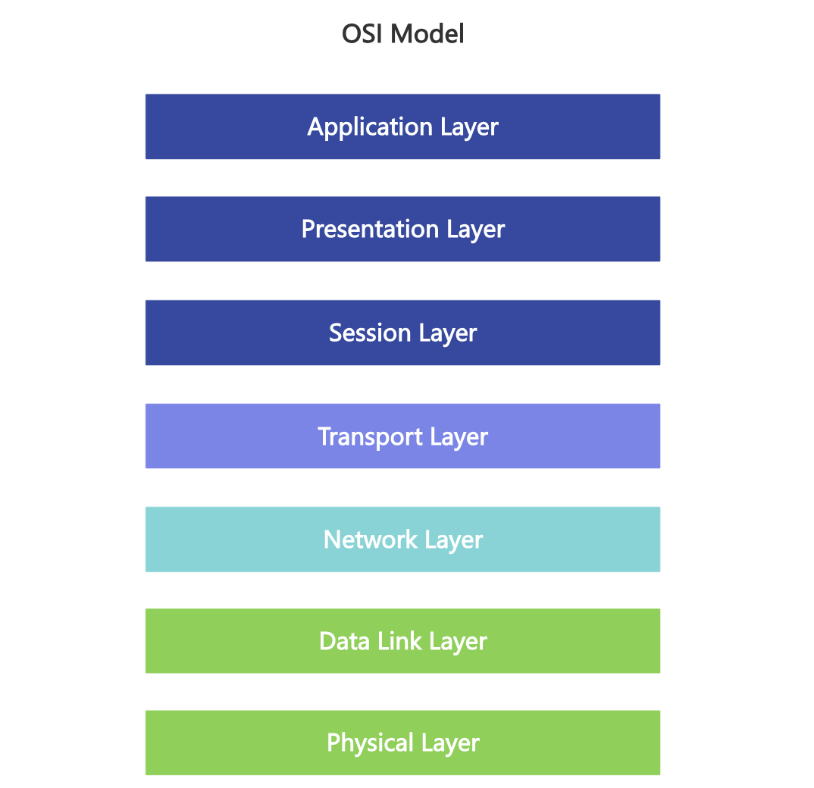
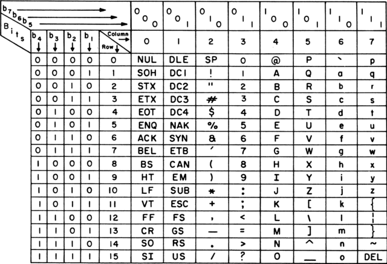
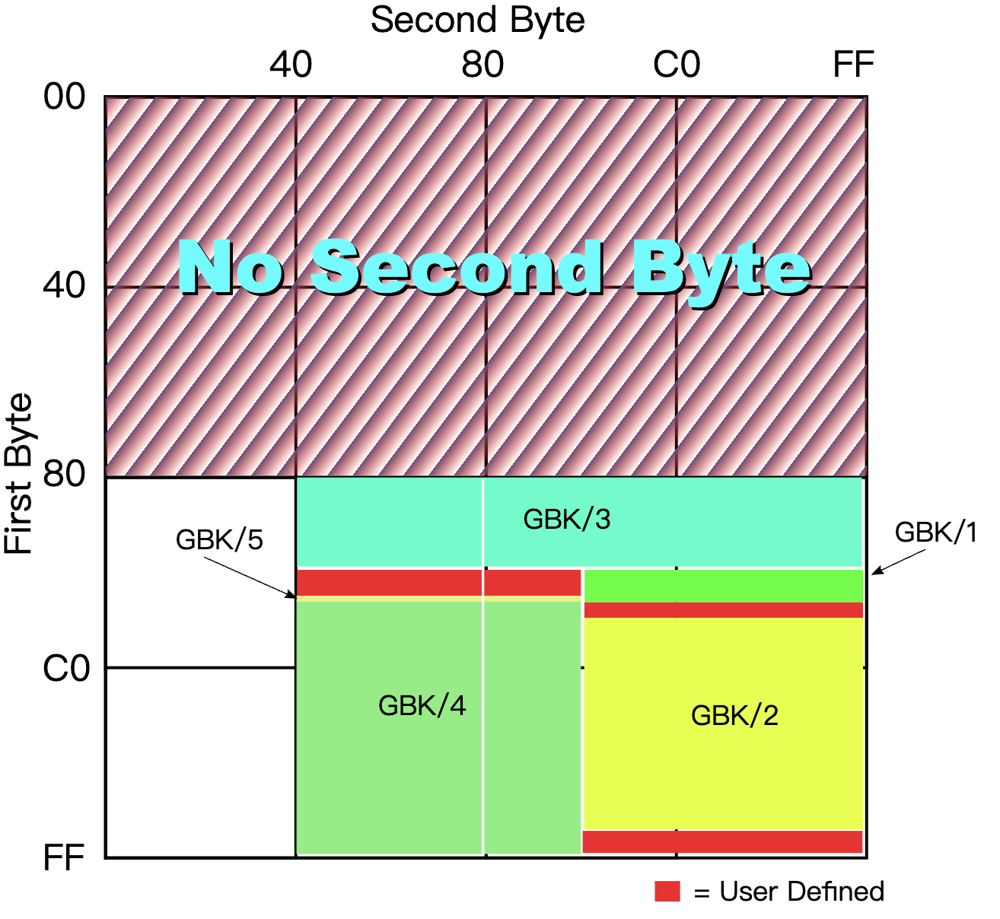
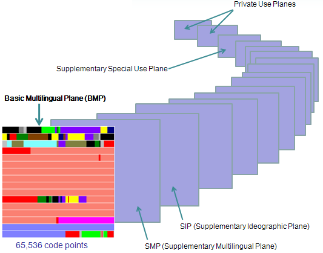
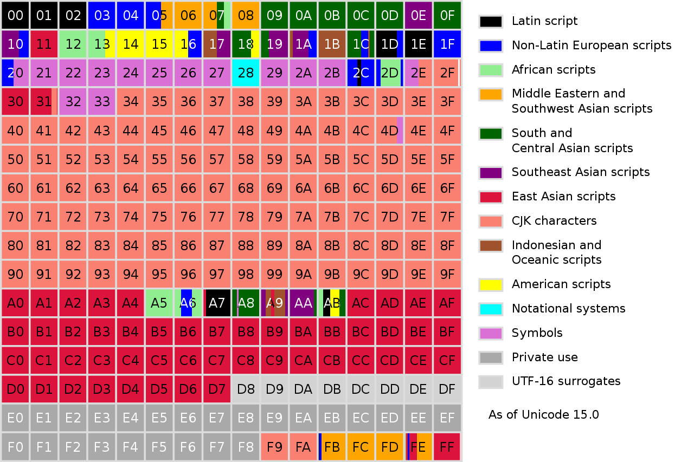

# 一篇文章读懂字符编码

## 为什么要有字符编码

我们知道，计算机底层只认识 0、1，即电路的断开、闭合，那么为了让计算机能够存储并处理人类世界中的文字、数字、标点符号等字符，我们需要将这些字符映射成计算机认识的 01 序列，也就是字节流，当然不能随意映射，需要有一个统一的字符和二进制的映射标准，这就是字符编码标准。

例如，ASCII 编码，其中“u”字符被编码为十进制 117，对应二进制 `0111 0101`，这个过程就是**编码**，即将字符转换成字节流的过程。当计算机采用ASCII编码的时候，读到了字节流 `0111 0101`，会根据 ASCII 编码将这个字节转换成“u”字符，这个过程就是**解码**，即将字节流转换成字符。

## 在分层模型中的体现

在 OSI 七层模型中，编码和解码发生表示层：



当我们接收一份数据的时候，从物理层一层一层的解析，这个过程中数据都是以二进制传输的，直到表示层，根据 ASCII、JPEG、MPEG、XML 等协议或格式，将二进制转换成字符、图片、视频、对象供应用层的应用和协议使用（HTTP、SMTP）。

发送数据则反过来，在表示层将字符等转换成二进制格式，再经过会话层、传输层等进行包装，直到物理层。

在 Java 中，我们将对象序列化成 JSON 格式的时候，就是将对象根据 JSON 和指定的字符编码转换成字节流的过程，以便进行传输和存储。

## 字符编码的诞生需要哪些步骤

首先，需要**确定字符集的范围**，如 ASCII 编码一共收录了 128 个字符，GB2312 字符集收录 7445 个字符，确定了字符集的范围，我们才能确定采用几个字节表示一个字符，例如 ASCII 编码采用一个字节就足以表示 128 个字符。

其次，需要**对字符进行逻辑编号**：

- 可以按顺序进行编号，例如：ASCII 中，A 为 65，B 为 66

- 还可以按照区位码的方式进行编号，例如，GB2312 中，汉字“王”，这个字被放在了第 45 区的第 85 位，所以“王”对应的区位码是 4585

最后，需要**将逻辑编号进行编码**，让计算机能够正确的读取，这个步骤我们需要思考两个问题：

**1. 计算机一次应该读取几个字节？**

有的字符编码一次读一个字节，有的字符编码一次读两个字节，还有的字符编码一次读四个字节，我们把计算机一次读取的字节数称为**码元（Code Unit）**。

**2. 几个码元表示一个字符？**

例如 ASCII 编码，码元为一个字节，那么一个字符占一个码元，即可表示 128 个字符，所以对于 ASCII 码，计算机一次读取一个字节，一个字节对应了一个字符。

但是，有的字符集，一个字符可能需要多个码元来表示，这就需要进行特定规则的编码，告诉计算机，几个码元表示的是一个字符。

例如 UTF-8 编码，码元也是一个字节，但是一到四个码元表示一个字符，这时候就需要一些编码规则，并按照这些规则将编号进行编码，那么计算机根据这个编码规则，就知道几个码元表示一个字符了（具体的规则后面的 UTF-8 会详解）。

故对于 UTF-8，计算机一次读取一个字节，然后根据 UTF-8 的编码规则，将一到四个字节转换成一个字符。

## ASCII

ASCII（American Standard Code for Information Interchange）编码，美国信息互换标准编码，单字节编码方案，最高位用于奇偶校验，所以一共 128 个字符，这个比较简单，直接将 0~127 这 128 个编号直接映射为单字节的二进制数据。

如下图所示：



## GB 系列

### GB2312

GB2312（GB 代表国标）是 1980 年我国发布的简体中文字符集，共收录 6763 个汉字以及 682 个全角字符。

GB2312 提出了分区的概念，一共 94 个区，每个区可以放 94 个字符（类似行和列），所以定位一个字符的方式就是在第几分区的第几位字符。

分区可以让字符分门别类的存放：

- 01 ~ 09 区：特殊符号、数字、英文字符、制表符等
- 10 ~ 15 区：待扩展
- 16 ~ 55 区：常用汉字（以拼音字母排序）
- 56 ~ 87 区：非常用汉字（以部首笔画排序）
- 88 ~ 94 区：待扩展

例如，汉字“王”，这个字被放在了第 45 区的第 85 位，所以王对应的区位码是 4585。

编码规则：

- 把区位码的区码和位码都加 160，45 + 160 = 205，85 + 160 = 245
- 分别拼成两个字节，`11001101 11110101`，对应 16 进制 CDF5

总结：

- 一个小于 127 的字符的意义与原来相同
- 两个大于 127 的字符连在一起时，就表示一个汉字，前面的一个字节（高字节）从 `0xA1` 用到 `0xF7`，后面一个字节（低字节）从 `0xA1` 到 `0xFE`

注意：

**1. 关于全角字符**

GB2312 并未收录 ASCII 编码中的字符，而是将其重新编成了两个字节，按照全角字符显示。全角字符是指长宽比为一比一的正方形的字符，适合中日韩的文字显示。ASCII 编码中的字符则显示为半角字符，半角字符是指宽度为全角一半的字符，适合英文的显示。

**2. 为什么将区位码加 160？**

为了避开 ASCII 字符中的不可显示字符（直接沿用，不再重新编码），即 0~31 个，及第 32 个，空格字符，所以在区位码的基础上，高位和低位分别加上 32，作为国标码，但是这种编码模式和 ASCII 是有冲突的，后来为了方便区分单字节编码还是双字节编码，部分厂商把双字节字符的二进制最高位从 0 换成了 1，相当于将区位码高位和低位再加上了 128，32 + 128 = 160，所以相当于区位码直接加了 160。

### GBK

GB2312 虽然满足了日常基本使用，但是还有有一些生僻字未收录，例如总理朱镕基的 “镕” 字、香港和台湾使用的繁体字都没有收录，所以出现了 GB2312 的扩展版本，GBK（K，扩展），兼容 GB2312，包括了 Unicode 1.1中的汉字，共收录了 21003 个汉字。

GB2312 采用了 94*94 的范围，GBK 将两字节能表示的区域进一步扩大，共计 23940 个码位：

- 首先不避开 ASCII 中不可显示的字符，能表示的区域就扩大成了 128*128，对应 16 进制为 `0x80*0x80`（`0x`代表 16 进制表示）。

- 进一步的，要想避免和 ASCII 发生冲突，只需要第一个字节大于 128 即可，读取的时候，如果一个字节大于 128，那么连续读取两个字节即可，所以第二个字节的范围可以进一步扩大，GBK 将第二个字节的范围从 GB2312 的 128 ~ 254 扩展到了 64 ~ 254。

布局图如下图所示：



其中：

- GBK/1 和 GBK/2 区域为原来的 GB2312 编码，GBK/1 代表非汉字区，GBK/2 代表汉字区
- GBK/3、GBK/4、GBK/5 为 GBK 新增区域
- 红色区域为用户自定义区域

注意，GBK 是国家有关部门与一些信息行业企业等一起合作推出的方案，并非官方标准，由于 Windows 95 的广泛使用，导致 GBK 成为事实标准。

### GB18030

2000 年，我国发布 GB18030 的初代版本 GB18030-2000，最新的为 2005 年的 GB18030-2005，包含多种我国少数民族文字，收入汉字 70000 余个。

GB18030 是一个多字节编码方案，有三种变长组合：

- 单字节，对应 ASCII
- 双字节，对 GBK 进行扩展，编码还是 GB 系列类似的规则
- 四字节，映射了 Unicode 中的字符

GB18030 完全兼容 GB2312，基本兼容 GBK，完全支持 Unicode，GB18030 只有少数操作系统支持，具体编码规则不再讲解。

## Unicode

Unicode 的历史如下：

- 1987 年，施乐公司的 Joe Becker 和苹果公司的 Lee Collins 和 Mark Davis 开始研究通用字符

- 1988 年，Joe Becker 发布了 Unicode 草案，该草案中 Unicode 采用 16 位编码模型，当时认为 16 位足以包含世界上任意字符

- 1991 年，成立了 Unicode 联盟，同年 Unicode 1.0 发布，共 7129 个字符

- 1992 年，Unicode 1.0.1 发布，包括了 20902 个 CJK 字符（CJK，中日韩统一表意文字，把分别来自中文、日文、韩文、越文中，起源相同、本义相同、形状一样的表意文字在 Unicode 中赋予相同的码点值）

- 1996年，Unicode 2.0 发布，Unicode 的 16 位不够用了，定义了代理区，同时新增个 16 个平面

- ...

- 2025年，Unicode 17.0 发布，添加了 4,803 个字符，其中绝大多数还是 CJK 字符，共计 159,801 个字符

上面提到，Unicode 最初是 16 位的，也就是 2 个字节，65,536 个编号，后续两个字节不够用了，就新增了 16 个平面，每个平面也都是两个字节，而最初的 Unicode，被称为第 0 平面，也叫做基本平面（Basic Multilingual Plane，BMP），后面新增的 16 个平面，被称作增补平面（supplementary planes）。

Unicode 字符集中的编号通常用下面方式表示：

```
U+hhhhhh
```

前两位表示位于哪个平面，取值为 `0x00-0x10`，故 Unicode 的最后一个码点，即第 16 个平面的最后一个码点的 Unicode 编号为 `U+10FFFF`；再如，”王“字的十六进制编号是 `738B`，所以我们就写成 `U+738B`。

Unicode 的 17 个平面如下图所示：



下面是基本平面的分布：



我们可以看到橘红色为 CJK 字符，占了基本平面中很大的一部分，还有浅灰色为 UTF-16 的代理区，后面会讲解。

### 编码方案

Unicode 的编号只是逻辑编号，在实际计算机传输的时候，依然要考虑我们开篇提到的两个问题：

- 计算机一次应该读取几个字节？
- 几个码元表示一个字符？

接下来我们看下主流的三种 Unicode 编码，UTF-8、UTF-16、UTF-32 各自采取的编码方案。

#### UTF-32

我们先看最简单的编码方案，UTF-32。

这种编码方案的码元采用 4 个字节。由于 Unicode 只有 17 个平面，每个平面是 2 个字节，4 个字节足以直接映射所有 Unicode 字符，所以 UTF-32 不需要任何编码，直接将 Unicode 逻辑编号直接映射为 4 字节编码即可，不够 4 个字节的高位补 0 即可。

例如：

字符 “u”，Unicode 编号是 `U+0075`，在第 0 平面，二进制 `1110101`，所以编码为：

```
00000000 00000000 00000000 01110101
```

再看字符“😂”，Unicode 编号是 `U+1F602`（[点此查询Unicode符号](https://unicode-table.com/cn/)），在第一增补平面，二进制 `0001 1111 0110 0000 0010`，所以就直接编码为：

```
00000000 00000001 11110110 00000010
```

UTF-32 的特点是定长编码，计算机在读取的时候，一次读取 4 个字符，并作为一个符号，但是无论任何字符，都是四个字节，浪费了大量空间，因此，UTF-32 应用很少。

#### UTF-8

接下来我们看 Unicode 最优秀的编码方案，UTF-8。

设计 UTF-8 主要的原因是 UTF-16 并不兼容 ASCII 码，所以 UTF-8 采用了单字节码元，兼容 ASCII 码，是变长编码，那么就要解决上面的第二个问题，几个码元表示一个字符？

UTF-8 采用了非常精巧的设计，根据首字节有几个连续的 1 的方式（0 为终止标志）来判断一个字符几个字节，非首字节都要用 10 开头（为了区别单字解释编码和多字节编码的首字节）：

- 如果首字节以 `0` 开头，是单字节编码（1 个码元），`0XXX XXXX`，共 7 个有效位
- 如果首字节以 `110` 开头，是双字节编码（2 个码元），`110XXXXX 10XXXXXX`，共 11 个有效位
- 如果首字节以 `1110` 开头，是三字节编码（3 个码元），`1110XXXX 10XXXXXX 10XXXXXX`，共16 个有效位
- 如果首字节以 `11110` 开头，是四字节编码（4 个码元），`11110XXX 10XXXXXX 10XXXXXX 10XXXXXX`，共21 个有效位
- ...

例如：

字符 “u”，Unicode 编号是 `U+0075`，二进制 `111 0101`，按照上述规则，编码为：

```
01110101
```

再如基本平面的字符“武”，编号为 `U+6B66`，二进制 `110 1011 0110 0110`，15 个有效位，应该采用三字节编码，填充至上述三字节编码格式中，并高位补 0：

```
11100110 101011 01 1010 0110
```

再看增补平面字符“😂”，Unicode编号是 `U+1F602`，二进制 `1 1111 0110 0000 0010`，17 个有效位，所以应采用四字节编码，填充至上述四字节编码格式中，并高位补 0：

```
11110000 10011111 10011000 10000010
```

UTF-8 的优点如下：

- 兼容 ASCII 编码，对于 ASCII 编码，只需一个字节即可
- 具备扩展性，不局限于 17 个平面
- 自动纠错性能好，适合网络传输，因为每个字符都有前缀，能方便的分辨一个字节是否是一个字符的开头

UTF-8 的缺点就是所有变长编码的通用问题，即在程序处理的时候，无法做到随机访问。

由于 UTF-8 优秀的设计，大部分网站采用的都是 UTF-8 编码，无历史包袱的软件、系统也基本都会采用 UTF-8 编码，大有一统之势。

注意，理论上 UTF-8 是可以无限扩大的，例如读到 `1111 1111 10xx xxxx`，可以认为是 9 个码元组成的一个字符，但是实际上，4 个字节编码，有 21 个有效位，而 Unicode 第 16 增补平面的最后一位编号为 `U+10FFFF`，也 21 个有效位，所以，4 个字节的 UTF-8 足以表示 17 个平面，这就是大家所说的 **UTF-8 为变长编码，由 1-4 个字节构成**，这也足以看出了 UTF-8 编码强大的扩展性。

#### UTF-16

由于 Unicode 最早设计就是 2 字节编码，那么直接将编号映射为 2 个字节的编码方式就是最简单的编码方式，即 UCS-2（ISO 组织的编码标准，后来 ISO 和 Unicode 联盟进行合作，二者编码基本一致）。

但是后来发现 2 个字节不够用了，ISO 提出了 UCS-4 的方案，即 4 个字节表示一个字符，与 UTF-32 的方式相同，而 Unicode 则提出了 UTF-16，采用代理机制实现拓展。

UTF-16 代理机制就是**采用两个位于基本平面代理区（Surrogate Zone）的码元（2 个字节），来表示一个增补平面的码点**。

增补平面一共 16 个，编号为 `0x10000 ~ 0x10FFFF`，共需要 20 位来表示。

Unicode 基本平面中的 `0xD800 ~ 0xDFFF` 区域被划定为代理区（上面 BMP 图中浅灰色区域，没有对应任何字符），对应的二进制为：`1101 1000 0000 0000 ~ 1101 1111 1111 1111` ，只要在代理区，那么二进制开头一定是 `1101 1`，共计 5 位，一个码元还剩下 11 个有效位，1 个位置可以表示两个代理码元的高低标志位，还剩下 10 个有效位，两个高低位码元加起来，刚好 20 位，而一个增补平面字符也刚好需要 20 位来表示。

20 位中，前 4 位表示了第几平面，所以最终形式如下：

```
1101 10pp ppxx xxxx  1101 11xx xxxx xxxx
```

其中 `pppp` 表示所在的平面，其他 16 位表示所在平面的位置的 2 进制，且上面形式中的第一位（第 6 位为 0）表示为高 16 位代理码元，后 16 位（第 6 位为 1）被称为低 16 位代理码元。

例如：字符“u”，Unicode 编号是 `U+0075`，二进制 `0111 0000`，在基本平面，那么就直接将其编号映射为编码：

```
00000000 01110101
```

再如基本平面的字符“武”，编号为 `U+6B66`，二进制 `0110 1011 0110 0110`，同样的，直接映射为编码：

```
0110 1011 0110 0110
```

又如增补平面字符“😂”，Unicode 编号是 `U+1F602`，二进制 `0001 1111 0110 0000 0010`，按照上面的形式进行填充（同样高位补零），最终编码如下：

```
1101 1000 0111 1101  1101 1110 0000 0010
```

UTF-16 的缺点如下：

- 编码复杂
- 不兼容 ASCII 编码
- 不具备扩展性，只能基于 17 个平面
- 同为变长编码，判断一个字符几个字节上，成本要比 UTF-8 高，UTF-8 只需要判断开头几个 1 即可
- 相比 UTF-8 存在字节顺序标记问题（后续会提到）

优点：

- 大部分中文编码为两个字节
- 兼容最初的 UCS-2 方案

所以使用 UTF-16 编码的多数都是较早支持 Unicode 的软件系统，Windows、Java 等，后续为了兼容选择 UTF-16，后续新软件没有必要使用 UTF-16。

### 字节顺序标记

字节顺序标记（byte order mark，BOM），在文本文件的最开头，有如下作用：

- 指示了文件使用的编码格式
- 指示了字符编码的高有效位是否存储在文件的初始位置，当字符编码的高有效位被存储在文件的初始位置，被称为”大端序“（big-endian），否则，称为”小端序“

Unicode 使用了 U+FEFF 字符作为字节标记顺序：

| 编码                     | BOM         |
| ------------------------ | ----------- |
| UTF-8                    | EF BB BF    |
| UTF-16BE (big-endian)    | FE FF       |
| UTF-16LE (little-endian) | FF FE       |
| UTF-32BE (big-endian)    | 00 00 FE FF |
| UTF-32LE (little-endian) | FF FE 00 00 |

以字符“u”为例：

| 编码     | 二进制                              |
| -------- | ----------------------------------- |
| UTF-16BE | 00000000 01110101                   |
| UTF-16LE | 01110101 00000000                   |
| UTF-32BE | 00000000 00000000 00000000 01110101 |
| UTF-32LE | 01110101 00000000 00000000 00000000 |

微软系统及系统软件钟爱 BOM，很多要求必须有 BOM，并不是所有程序都支持 BOM，类 Unix 系统不推荐添加 BOM，所以在解析的时候，文件的开头需要注意是否有 BOM。

注意：UTF-8 不存在顺序问题，如果出现 BOM 仅仅是为了说明该编码格式为UTF-8。

### 在线转换注意

有时候想查一下一个字符对应的 UTF-8 编码是啥，就会去搜索 UTF-8 在线转换，但是实际上，大部分中文在线UTF-8 转换工具都是错的，经测试（2022年11月18日），百度搜索出来第一页的 UTF-8 在线转换中，只有一个是对的，其他所有都是返回的该字符的 UTF-16。

例如，上面测算过的“😂”，对应的 Unicode 为 `U+1F602`，正确的UTF-8编码为 `0xF0 9F 98 82`，但很多在线工具返回的是 `&#xD83D;&#xDE02`，这是该字符的 UTF-16 编码。

在查询的字符的 UTF-8 编码的时候注意，可以使用如下转换工具：[UTF8 Encode Decode](https://convertcodes.com/utf8-encode-decode-convert-string/)、[Unicode字符百科](https://unicode-table.com/cn/)。

### Unicode 相关

#### Java 中的影响

Java 设计之初的基本假设是，基于 Unicode，设计 Char，上面也提到了，起初 Unicode 是16位编码，定长的，自然 Java 的 Char 也设计为 16 位，两个字节，表示一个字符。

但是 Unicode2.0，设计了增补平面，两个字节已经不够用了，Java 为了兼容旧的接口和虚拟机，没有直接切换为 UTF-8，而是采用 UTF-16 编码，一个 Char 字符表示 UTF-16 的一个码元，而不是一个真正的字符，增补字符采用两个 Char 来表示。

详细历史和相关 API 详见：[Supplementary Characters in the Java Platform](https://www.oracle.com/technical-resources/articles/javase/supplementary.html)。

代码示例如下：

```java
public class CharacterSet {
    public static void main(String[] args) {
        String s = "😂";
        ///编译报错
        //char c = '😂';
        char[] charArray = s.toCharArray();
        //结果为2
        System.out.println(charArray.length);
        //结果为2
        System.out.println(s.length());
        //新API 获取真正字符数 结果为1
        System.out.println(s.codePointCount(0, s.length()));
    }
}
```

#### MySQL字符集

2004 年，MySQL 4.1 是第一个支持字符集和排序的版本，其中就包括了 UTF-8，但是由于大部分字符都在基本平面，MySQL 选择了优化，规定 UTF-8 为三个字节，当时几乎可以处理所有现代语言。

2010 年，MySQL 5.5 开始支持 4 个字节的 UTF-8，而且引入了新的字符集，utf8mb4。

所以 utf8mb4 才是未被阉割的 UTF-8，**在我们使用 MySQL 的时候，最好使用 utf8mb4 来作为字符集**。

#### 正则表达式判断汉字

当我们需要判断输入字符是否是汉字的时候，大多数文章都会告诉你去会判断其 Unicode 是否在`\u4e00-\u9fa5`，这个区间其实是 Unicode 1.0.1 发布，添加的 20902 个 CJK 字符，其实已经包括了大部分中文简体、繁体，但是后续又陆陆续续在基本平面和增补平面添加了一些 CJK 字符，**需要根据需求场景来判断是否还要算上其他 CJK 区间**。

#### 关于 Emoji

Emoji 源自 1997 年的日本手机的操作系统中，后来，一些公司也将 Emoji 引入到操作系统中，谷歌和苹果在 Unicode 的私有区域实现了 Emoji， 2010 年，Unicode 联盟发布 Unicode 6.0，其中包括了 722 个 Emoji。

Emoji 的字符编码是没有版权的，遵守 Unicode 联盟的条款即可，但是对应不同公司设计的图案是有版权的，好比字符编码和字体的关系一样，当然，也有部分公司的设计图案是开源的，例如 Google。

例如，不同公司设计的 Face with Tears of Joy 表情图案（`U+1F602`）：


注意，我们在使用软件的时候，会发现不同软件也有自己的表情符号，例如贴吧的滑稽、微博的狗头等，这些其实是多个字符按照一定规则的一种映射，在应用层面进行转换，只能在应用内部使用。例如，贴吧的滑稽：`#(滑稽)`，微博的狗头：`[doge]`

## 总结

- 为什么要有字符编码，原因就是计算机只能识别 0、1 字符，我们需要按照一定规则将现实符号映射为字节流，这个映射标准就是字符编码
- 一个字符集的诞生，需要注意两个问题：计算机一次应该读取几个字节？几个码元表示一个字符？
- GB 系列编码，都采用了类似的编码方案，区位码作为编号，并简单射影到两个字节上
- Unicode 从最开始采用了双字节编码方案，后来增加了 16 个增补平面
- UTF-8、UTF-16、UTF-32 各自的编码方案及优缺点：
  - UTF-8 最为优秀，兼容 ASCII 编码，使用率也是最高的
  - UTF-16 主要考虑了历史兼容问题，有历史包袱的软件系统会采用 UTF-16
  - UTF-32 特点是定长编码、空间占用大
- 最后 Unicode 在 Java、MySQL 中存在一些历史问题，了解 Unicode，能帮助我们判断一个字符是否是汉字，同时，生活中常见的 Emoji 其实就是 Unicode 字符

## 参考

1. [字符集与编码（九）——GB2312，GBK，GB18030](https://my.oschina.net/goldenshaw/blog/352859)
1. [维基百科：GB 2312](https://zh.m.wikipedia.org/zh-hk/GB_2312)
1. [维基百科：全角和半角](https://zh.wikipedia.org/wiki/%E5%85%A8%E5%BD%A2%E5%92%8C%E5%8D%8A%E5%BD%A2)
1. [维基百科：GB 18030](https://en.wikipedia.org/wiki/GB_18030)
1. [字符集与编码（四）——Unicode](https://xiaogd.net/md/字符集与编码（四）-unicode)
1. [维基百科：Unicode](https://en.wikipedia.org/wiki/Unicode)
1. [维基百科：Plane_(Unicode)](https://en.wikipedia.org/wiki/Plane_(Unicode))
1. [维基百科：CJK Unified Ideographs](https://en.wikipedia.org/wiki/CJK_Unified_Ideographs)
1. [维基百科：UTF-8](https://en.wikipedia.org/wiki/UTF-8)
1. [维基百科：UTF-16](https://en.wikipedia.org/wiki/UTF-16)
1. [维基百科：Byte order mark](https://en.wikipedia.org/wiki/Byte_order_mark)
1. [刨根究底字符编码之十三——UTF-16编码方式](https://zhuanlan.zhihu.com/p/27417641)
1. [刨根究底字符编码之十二——UTF-8究竟是怎么编码的](https://zhuanlan.zhihu.com/p/27364614)
1. [刨根究底字符编码之十一——UTF-8编码方式与字节序标记BOM](https://zhuanlan.zhihu.com/p/27222802)
1. [Supplementary Characters in the Java Platform](https://www.oracle.com/technical-resources/articles/javase/supplementary.html)
1. [MySQL 8.0: When to use utf8mb3 over utf8mb4?](https://dev.mysql.com/blog-archive/mysql-8-0-when-to-use-utf8mb3-over-utf8mb4/)
1. [Java 为什么使用 UTF-16 而不是更节省内存的 UTF-8？](https://www.zhihu.com/question/308677093/answer/2748648048)
1. [维基百科：Emoji](https://en.wikipedia.org/wiki/Emoji)
1. [表情符号是否受版权保护](https://zhuanlan.zhihu.com/p/494278681)


