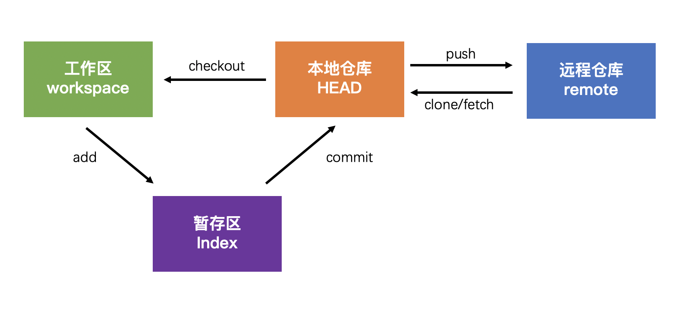
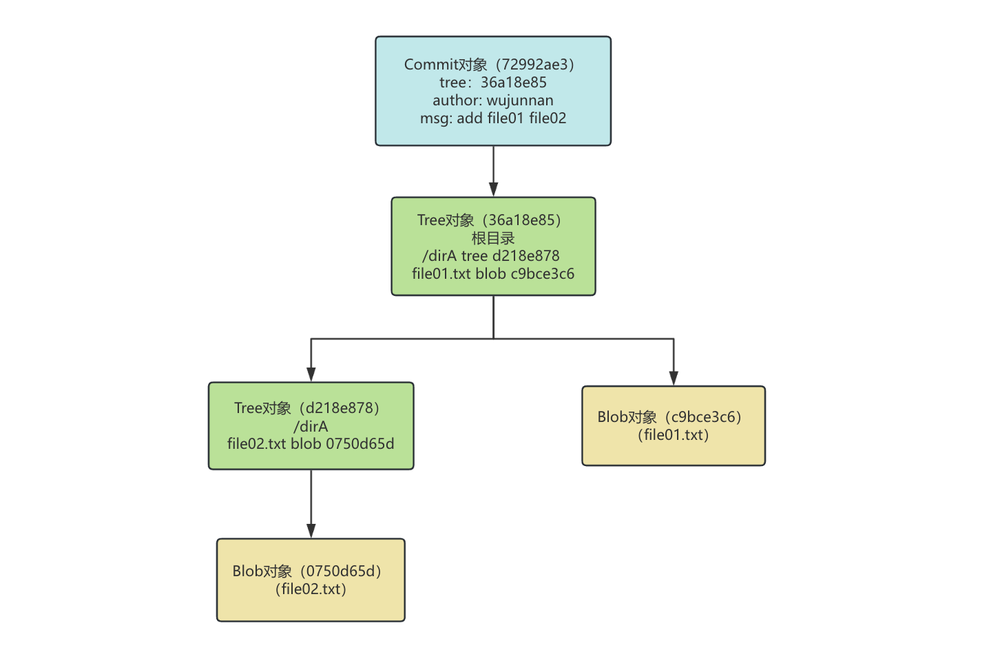
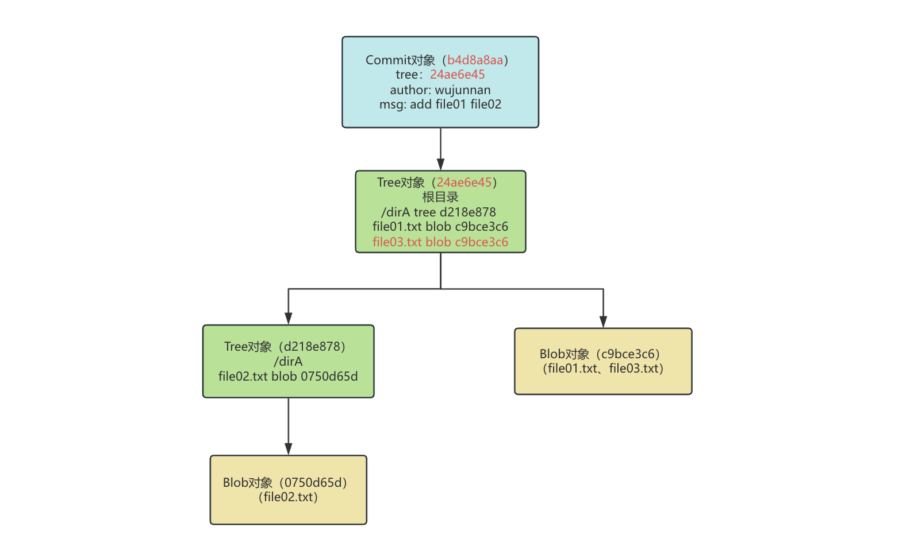
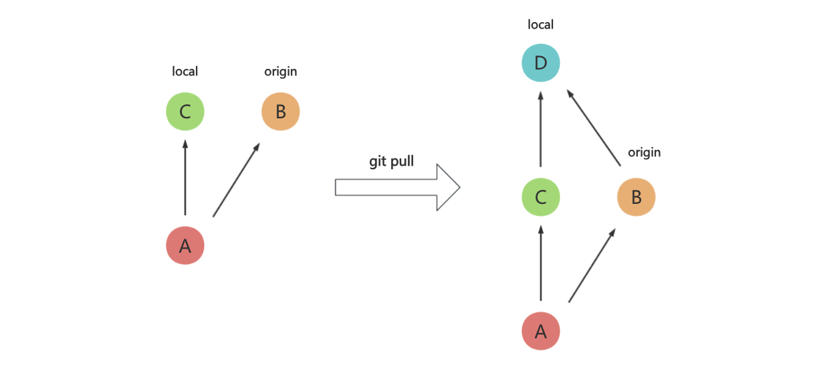
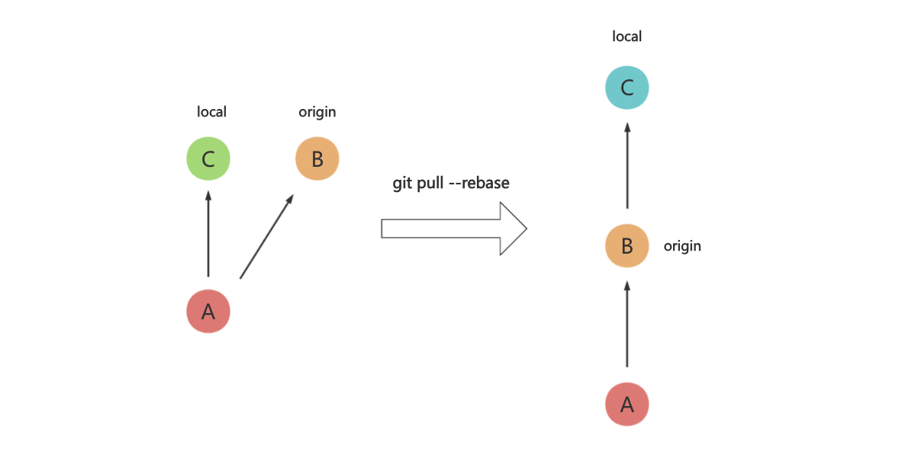
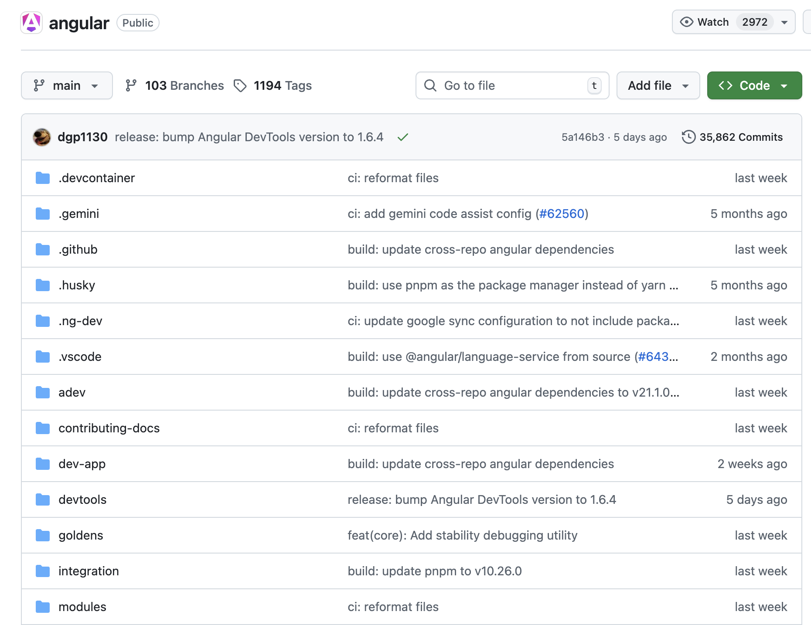
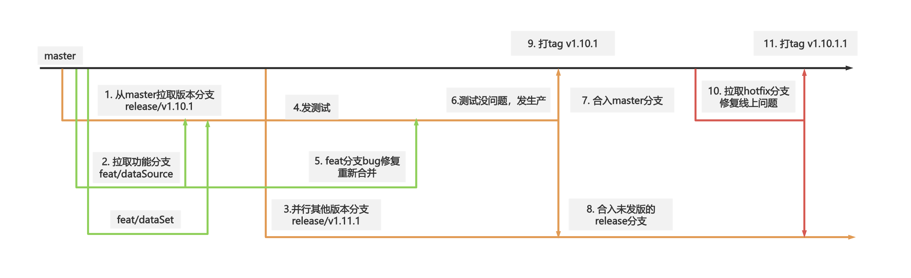

# 深入理解Git与实践

## Git 是什么

1991 年，Linus Torvalds 还是芬兰赫尔辛基大学的一名学生，当时 Intel 80386 架构比较受欢迎，他们教学使用的 MINIX 系统（类 UNIX 系统）对其兼容得并不是很好，而且限制源代码的修改。于是 Linus Torvalds 决定开发一套适配他硬件的，与操作系统无关的程序，即日后影响深远的 Linux 内核。

后来 Linus 采用 GNU 通用公共许可证（GPL）发布 Linux，这使得 Linux 成为一个允许任何人查看、修改的真正自由软件。随后世界各地的开发者都开始为 Linux 贡献代码，最初，这些开发者将源代码的 diff 通过邮件发送给 Linus，Linus 手动合并代码。随着代码量和贡献人数的增长，选择一个版本控制系统（VCS）来提升开发效率已经迫在眉睫了。

Linus 拒绝使用 CVS 等集中式的版本控制系统，因为它们效率低下且速度慢。2002 年 2 月，Linus 最终决定采用分布式的 BitKeeper 来管理 Linux 内核代码。BitKeeper 并非开源的，但它提供了一个免费的版本给 Linux 社区开发者使用，同时许可协议规定：使用者不能同时开发其竞争产品。

在 Linus 看来，BitKeeper 虽然并非完美，但是比当时其他的版本控制系统领先太多了，BitKeeper 的使用也显著提高了 Linux 的开发效率。然而，社区中有一些人有着对开源的纯粹追求，坚持反对使用非开源的 BitKeeper 来管理开源的 Linux。2005 年，澳大利亚开发者 Andrew Tridgell 对 BitKeeper 进行了逆向工程，触犯了其严格的许可协议，最终BitKeeper撤销了对内核开发团队的免费授权。

于是，Linus “被迫” 开发一款新的 VCS 工具，在大概 4 个月的构思之后，Linus 仅开发了不到 10 天，在 2005 年 4 月完成了 Git 初代版本的发布，四个月后，Linus 将 Git 项目交接给了来自日本的早期贡献者 Junio Hamano，Git 功能也在不断完善。

后来，随着 Ruby on Rails 等社区的使用和 Git 托管平台 GitHub 的崛起，Git 开始被广泛使用，Stack Overflow 2022 年的一项[调查](https://survey.stackoverflow.co/2022/#section-version-control-version-control-systems)显示：Git 的市场占有率高达 94%，在版本管理领域展现出绝对的统治力，成为目前事实上的行业标准。

接下来我们一起了解下 Git 的设计哲学。

> *Linus Torvalds 在 2012 年的一次演讲中表达对 NVIDIA 的不满，图片来自：[Linus Torvalds: "So NVIDIA, F\*ck you!"](https://www.youtube.com/watch?v=Q4SWxWIOVBM)*。

## Git 特点

1. **Git 是分布式版本控制系统而不是集中式版本控制系统**

   分布式的特点使得我们本地也是一个完整的版本库，这样我们就可以在离线的状态下执行很多操作，同时还能看到完整的历史版本。而集中式，如 Subversion（SVN），几乎所有操作都要保证和中央服务之间网络连接，而且中央数据库一旦丢失，每个人只有本地快照，整个项目的历史记录都没了。

2. **Git 存储的是快照，而不是差异**

   许多版本控制系统，例如 SVN，存储的是所管理的文件组随时间所做出的变更，也就是说每个版本存储的是和上个版本的变更。而 Git 则是存储的快照，每个版本就是文件组的一个快照，当然，Git 会进行一些优化，高效存储。

3. **轻量到极致的分支**

   多数版本控制系统中，分支都成本高昂，常常需要对整个源码目录复制一遍，而 Git 的分支则只是一个引用，创建和切换分支非常迅速，Git 鼓励开发者在工作流中经常创建和使用分支。

## Git 原理

下图是 Git 的仓库模型：



### Git 存储的是快照，而不是差异

我们新建一个 git demo 项目，并在项目根目录执行 `git init` 命令，我们发现多了一个 `.git` 隐藏目录，意味着该项目被 Git 管理，并且有关 Git 的一切，都在该目录中：

```
$ tree -L 1 .git
.git
├── config
├── description
├── HEAD
├── hooks
├── objects
└── refs
```

其中，config 文件包含了项目特定的配置，description 仅限于 GitWeb 程序使用，无需关心，hooks 目录用于存储钩子脚本，剩下的四项很重要：HEAD，index 文件（还未创建）、objects 目录和 refs 目录，我们后面会提到。

objects 目录就是存储各种对象的，Git 主要提供了以下三种对象：

- blob 对象
- tree 对象
- commit 对象

其中，blob 对象和 tree 对象定义了文件树。

我们在工作目录下添加文件，如下：

```
$ echo "file01 version1" > file01.txt
$ mkdir dirA
$ echo "file02 version1" > dirA/file02.txt
$ tree -L 2  .
.
├── dirA
│   └── file02.txt
└── file01.txt
```

将这些文件添加到暂存区：

```
$ git add .
```

然后查看 `.git/objects` 目录：

```
$ tree -L 3 .git/objects
.git/objects
├── 07
│   └── 50d65db473257b0cf510d98b0a86a39628114f
├── c9
│   └── bce3c65c7459bb2f1d56aed6b1e91ac071b9c2
├── info
└── pack
```

其中每种对象都会生成一个长度为 40 的 SHA-1 散列值，**Git 通过散列值来查找对应的对象，而不是文件名**，该散列值将作为对象的文件名存储在 objects 目录中（散列值的前两位是单独的目录）。

其中 blob、tree、commit 对象的内容都是二进制形式的，无法直接打开查看，需要 `git cat-file` 命令来查看：

```
$ git cat-file -t 0750d65db473257b0cf510d98b0a86a39628114f
blob
$ git cat-file -p 0750d65db473257b0cf510d98b0a86a39628114f
file02 version1

$ git cat-file -t c9bce3c65c7459bb2f1d56aed6b1e91ac071b9c2
blob
$ git cat-file -p c9bce3c65c7459bb2f1d56aed6b1e91ac071b9c2
file01 version1
```

我们发现，Git 将两个文件都转换成了 blob 类型的对象存放到了 `.git/obects` 中。

暂存区 Git 又是如何表达的呢？Git 把上述所有blob对象的散列值，存在 `.git/index` 文件中，**index 文件，即我们所说的暂存区**，通过如下命令可以查看 `.git/index` 中的内容：

```
$ git ls-files -s
100644 0750d65db473257b0cf510d98b0a86a39628114f 0   dirA/file02.txt
100644 c9bce3c65c7459bb2f1d56aed6b1e91ac071b9c2 0   file01.txt
```

接下来，我们提交变更：

```
$ git commit -m 'add file01 file02'
```

再次查看 `.git/objects` 目录：

```
$ tree -L 3 .git/objects
.git/objects
├── 07
│   └── 50d65db473257b0cf510d98b0a86a39628114f
├── 36
│   └── a18e85c612da8cb95ac16e58d693d42f77390f
├── 72
│   └── 992ae3c1a8c700ee3d1da0c53b7323e2f58643
├── c9
│   └── bce3c65c7459bb2f1d56aed6b1e91ac071b9c2
├── d2
│   └── 18e878d6721ac8934191ac46f4ff90ad24fcfd
├── info
└── pack
```

查看新增的对象：

```
$ git cat-file -t 36a18e85c612da8cb95ac16e58d693d42f77390f
tree
$ git cat-file -p 36a18e85c612da8cb95ac16e58d693d42f77390f
040000 tree d218e878d6721ac8934191ac46f4ff90ad24fcfd    dirA
100644 blob c9bce3c65c7459bb2f1d56aed6b1e91ac071b9c2    file01.txt

$ git cat-file -t d218e878d6721ac8934191ac46f4ff90ad24fcfd
tree
$ git cat-file -p d218e878d6721ac8934191ac46f4ff90ad24fcfd
100644 blob 0750d65db473257b0cf510d98b0a86a39628114f    file02.txt
```

可以看到，commit 后新增了两个 tree 对象：

- 36a18e85 tree 对象代表项目根目录，里面记录了根目录下的所有对象，即 dirA tree 对象和 file01.txt blob 对象
- d218e878 tree 对象代表 dirA 目录，里面记录了 file02.txt blob 对象

其中，100644/040000 为文件模式，100644 表示这是个普通文件，040000 表示这是一个普通目录

```
$ git cat-file -t 72992ae3c1a8c700ee3d1da0c53b7323e2f58643
commit
$ git cat-file -p 72992ae3c1a8c700ee3d1da0c53b7323e2f58643
tree 36a18e85c612da8cb95ac16e58d693d42f77390f
author wujunnan <xxxx@outlook.com> 1766315458 +0800
committer wujunnan <xxxx@outlook.com> 1766315458 +0800

add file01 file02
```

还新增了一个 commit 对象，其中：

- tree 代表提交此刻项目**根目录的 tree 对象**的散列值
- parent 为父 commit 的散列值（第一个 commit 没有父 commit）
- author/committer 是作者、提交者信息
- add file01 file02 为 commit message

以上三种对象就可以实现对一次提交的描述，并且可以还原出整个目录，步骤如下：

1. 通过散列值找到对应的 commit 对象
2. 从 commit 对象中找到对应的根目录 tree 对象
3. 从根目录 tree 对象找到根目录下的 blob 对象和 tree 对象，blob 对象是二进制的，通过解析后还原出原文件，tree 对象则继续重复此步骤，从而递归的解析出整个工作目录

示意图如下：



通过以上部分，你应该已经理解，Git 一次提交存储的是快照，而不是差异，一个 commit 节点即可还原出整个目录。

### 高效存储

上面我们提到，Git 一次提交存储的是快照，而不是差异，那很容易产生这样的疑惑：每次提交都要存储全量快照吗，那一个项目动辄成百上千个 commit，那得存储多少文件？

所以接下来，我们看下 Git 是如何高效存储的。

**相同数据只存储一次**

Git 对于相同的文件内容，只会存储一次，例如我们再在项目根目录下新建一个文件 file03.txt，保证和 file01.txt 文件内容相同：

```
$ echo "file01 version1" > file03.txt
$ tree -L 2
.
├── dirA
│   └── file02.txt
├── file01.txt
└── file03.txt
```

分别使用 `git hash-object` 命令计算两个文件的散列值，发现 file01.txt 和 file03.txt 是同一个 blob 对象：

```
$ git hash-object file03.txt
c9bce3c65c7459bb2f1d56aed6b1e91ac071b9c2
$ git hash-object file01.txt
c9bce3c65c7459bb2f1d56aed6b1e91ac071b9c2
```

示意图如下：



**压缩相似的内容**

如果我们的改动只有区区几行，Git 可以采用增量的方法来存储这些文件，执行 `git gc` 命令，不仅会清理无用的对象，还会将松散的对象（`.git/objects` 下的）进行压缩，存储 `.git/objects/pack` 中。

在新增上面的 file03.txt 之前，我们查看过 `.git/objects` 下的文件：

```
$ tree -L 3 .git/objects
.git/objects
├── 07
│   └── 50d65db473257b0cf510d98b0a86a39628114f
├── 36
│   └── a18e85c612da8cb95ac16e58d693d42f77390f
├── 72
│   └── 992ae3c1a8c700ee3d1da0c53b7323e2f58643
├── c9
│   └── bce3c65c7459bb2f1d56aed6b1e91ac071b9c2
├── d2
│   └── 18e878d6721ac8934191ac46f4ff90ad24fcfd
├── info
└── pack
```

新增 file03.txt 之后，`.git/objects` 下的文件如下，新增了两个对象，分别是一个 commit 对象和一个根目录 tree 对象：

```
$ tree -L 3 .git/objects
.git/objects
├── 07
│   └── 50d65db473257b0cf510d98b0a86a39628114f
├── 24
│   └── ae6e45993f3e2c99fbec1b1a5e9cbf183f429c
├── 36
│   └── a18e85c612da8cb95ac16e58d693d42f77390f
├── 72
│   └── 992ae3c1a8c700ee3d1da0c53b7323e2f58643
├── b4
│   └── d8a8aa4a2f19abe2a908bbc805efb3f919bf50
├── c9
│   └── bce3c65c7459bb2f1d56aed6b1e91ac071b9c2
├── d2
│   └── 18e878d6721ac8934191ac46f4ff90ad24fcfd
├── info
└── pack
```

执行完 `git gc` 命令之后，Git 进行了清理和压缩，如下：

```
$ git gc
Enumerating objects: 7, done.
Counting objects: 100% (7/7), done.
Delta compression using up to 8 threads
Compressing objects: 100% (4/4), done.
Writing objects: 100% (7/7), done.
Total 7 (delta 1), reused 0 (delta 0), pack-reused 0

$ tree -L 3 .git/objects
.git/objects
├── info
│   ├── commit-graph
│   └── packs
└── pack
    ├── pack-f44a882a5238fda1e50dda6c4fafe10fef05c200.idx
    └── pack-f44a882a5238fda1e50dda6c4fafe10fef05c200.pack
```

当然日常我们不必手动执行 `git gc`命令，Git 会在特定场景下自动触发。

### 轻量到极致的分支

我们可以通过一个 commit 节点的散列值来复原整个工作区，但是，我们不可能去记忆这长达 40 位的散列值，Git 的分支和标签存储了某次提交（commit 对象）的散列值。例如，我们找到了 master 分支，就找到了 master 分支对应的 commit 对象，之后 Git 就可以通过上述步骤还原出整个工作区，标签同理。

标签和分支就存储在 `.git/refs` 目录中，如下：

```
$ git checkout -b feature/a
Switched to a new branch 'feature/a'
$ git tag v0.0.1
$ tree -L 3 .git/refs
.git/refs
├── heads
│   └── feature
│       └── a
└── tags
    └── v0.0.1
```

其中：

- heads 指本地分支
- tags 指本地标签

可以看到，这些**分支或标签里面存储的仅仅是某次提交的散列值**：

```
$ cat .git/refs/heads/feature/a
b4d8a8aa4a2f19abe2a908bbc805efb3f919bf50
$ cat .git/refs/tags/v0.0.1
b4d8a8aa4a2f19abe2a908bbc805efb3f919bf50
```

远程分支也同样存储在 `.git/refs` 中，我们在 Github 新建一个仓库，然后将本地的仓库进行 push：

```
$ git checkout -b master
Switched to a new branch 'master'
$ git remote add origin git@github.com:junnanwu/git_demo.git
$ git push -u origin master
```

可以看到，remotes 里面即是我们的远程分支：

``` 
$ tree -L 3 .git/refs
.git/refs
├── heads
│   ├── feature
│   │   └── a
│   └── master
├── remotes
│   └── origin
│       └── master
└── tags
    └── v0.0.1
```

Git 是如何知道我们当前是哪个分支的呢？答案是通过 `.git/HEAD` 文件，HEAD 文件里面记录我们当前所在的分支：

```
$ cat .git/HEAD
ref: refs/heads/master
```

HEAD 里面也可以存储某个 commit 的散列值，此时即为 HEAD 分离状态，执行 `git checkout <hash|tag>` 命令切换到某个标签或 commit 节点即会进入 HEAD 分离状态。

另外，我们执行 `git checkout branch` 命令切换分支的时候，实际上就是修改了 `.git/HEAD` 文件，将其修改为我们要切换的目标分支，也就是对应的 commit 对象。

怎么样，新建、切换分支够轻量级吧？

Git 的设计让人感觉非常舒适，简单且高效。

接下来我们看一些工作中的 Git 实践。

## Git 工作实践

### 正确理解 Origin

之前我们有个需求，需要在香港搭一套新的环境，该怎么将大陆环境的代码同步到香港环境呢，一些同事在手动复制代码，麻烦又容易出错，其实理解了 origin 是什么，这个问题也就迎刃而解了。

**origin 是在执行 `git clone` 命令时远程仓库的默认名字**，而且 `git push` 等很多命令中，如果不指定远程仓库，默认远程仓库也是 origin，所以我们在执行 `git remote` 命令的时候，也习惯定义默认远程仓库为 origin：

```
$ git remote add origin git@github.com:junnanwu/git_demo.git
```

`git remote` 完整命令格式如下：

```
git remote add <name> <url>
```

那我们再给我们的项目添加一个远程仓库，在 gitee 上新建一个远程仓库，然后执行下面的命令，即可定义一个名字叫 gitee 的远程仓库：

```
$ git remote add gitee https://gitee.com/mrwujunnan/git_demo.git
$ git push -u gitee master
```

查看我们配置的远程仓库：

```
$ git remote -v
gitee   https://gitee.com/mrwujunnan/git_demo.git (fetch)
gitee   https://gitee.com/mrwujunnan/git_demo.git (push)
origin  git@github.com:junnanwu/git_demo.git (fetch)
origin  git@github.com:junnanwu/git_demo.git (push)
```

再次查看 `.git/refs`

```
$ tree -L 3 .git/refs
.git/refs
├── heads
│   ├── feature
│   │   └── a
│   └── master
├── remotes
│   ├── gitee
│   │   └── master
│   └── origin
│       └── master
└── tags
    └── v0.0.1
```

当我们想拉取 gitee 仓库的内容的时候，我们可以执行如下命令：

```
$ git pull gitee
```

回到上面的需求，对于香港项目来说，origin 对应了香港的远程仓库，gitee 对应的不就是大陆环境的远程仓库嘛，配合 `git cherry-pick` 命令获取你想要的功能即可。

### 更简洁的 Commit 历史

之前有同事，上线一个功能，好家伙，连续十几个 commit，而且 message 都是：“提交代码”... 当我们想寻找历史某个功能的具体代码变更的时候，该怎么定位 commit 呢？

一个有追求的开发者应该保持简洁的 commit 历史和 commit message 。

接下来我会分享三种常用的技巧来使得我们的 commit 历史更简洁。

**`git commit --amend`**

相信在实际开发中，常有这样的场景：写一个功能接口，提交了 commit，突然发现 Java 代码有一个 import 导入没有用到，作为强迫症的我们肯定不能接受，删除无用 import 语句之后，再次提交相同的 commit，这就造成了冗余的 commit。

我们可以使用如下命令，将本次修改合并到前一个 commit：

```
$ git commit --amend
```

该命令会删除前一次的 commit，然后再创建一个新的 commit，相当于 git reset + git commit。

那如果前面有多个冗余的 commit，如下面的情况，希望将最新的三个 commit 合并为一个，那该怎么办呢？

```
* cc2b3d3 - (HEAD -> feature) add t3
* 59361e9 - add t2
* f7e2acd - add t1
* 139199a - base
```

**`git rebase -i`**

这个时候，可以使用 `git rebase` 命令的交互模式：

```
$ git rebase -i 139199a
```

将弹出的交互式窗口的内容修改为下（即将后面两个节点前的 pick 修改为 `squash` 或 `s`）：

> s, squash <commit> = use commit, but meld into previous commit.

```
pick d20150f add t1
squash 59361e9 add t2
squash cc2b3d3 add t3
```

然后再调整合并后的 message 信息，最后，三个 commit 即会被合并为一个（rebase 会生成新的节点，即 b6f2233）：

```
* b6f2233 - (HEAD -> feature) add t1、t2、t3
* 139199a - base
```

**`git pull --rebase`**

另外，还有一种常见的场景：小张、小李都基于同一分支进行开发，假设当前最新的提交是 A，小张先开发完毕，提交 B，并 push 到远程仓库，小李后开发完毕，提交 C，这个时候，当小李进行 push 的时候，由于远程仓库有比本地分支更新的内容，所以远程仓库会拒绝 push。

此时，我们会执行 `git pull`，将远程更新的内容拉到本地，然后再执行 `git push`，这次 push 成功了，但是我们查看 commit 历史，会发现多了一个 merge 节点 D：



但是，如果我们执行 `git pull --rebase`，那么就会将 C 的 base 修改为 B，我们就会得到了一条直线（此 C 已经非彼 C 了，是一个新的 commit ）：



所以，**请用 `git pull --rebase` 代替 `git pull` 操作**。

上面我们提到了三个技巧来让我们的 Git 提交记录更简洁，但是值得注意的是，这些操作都会修改历史提交，假如你修改了其他同事的历史提交，然后 `git push --force`，你的同事 `git pull` 之后，代码就可能丢失。所以，请熟练掌握后再使用这些命令，另外，切记：

**不要修改远程仓库公共分支的 commit！不要修改远程仓库公共分支的 commit！不要修改远程仓库公共分支的 commit！**

上面三个操作，在多数 IDE，例如 IDEA 中，都有对应的图形化操作，可自行搜索。

### 更简洁的 Commit Message

commit message 是给人看的，如果每次提交都写 “提交代码”，那以后寻找历史变更将是一个灾难。

[Angular](https://github.com/angular/angular) 团队的 Git commit message 规范是比较流行的，如下图：



参考：[Git Commit Guidelines](https://github.com/angular/angular.js/blob/master/DEVELOPERS.md#-git-commit-guidelines)，具体格式如下：

```
<type>(<scope>): <subject>
<BLANK LINE>
<body>
<BLANK LINE>
<footer>
```

但是上述格式较为复杂，通过简化，我们可以按照如下规范提交：

```
<type>(<scope>): <subject>
```

- `<type>` 为提交类型
  - feat：新功能
  - fix：修复
  - style：格式（不影响代码运行的改动）
  - refactor：重构
  - test：测试
  - perf：优化
  
- `<scope>` 为影响范围，可选

- `<subject>` 为 commit 的简短的描述，不超过 50 字符，结尾不要加标点

例如：

```
feat: 用户查询接口开发
fix(DAO): 修复用户查询未判空
feat(Config): 增加鉴权相关配置
```

按照此规范以后，我们应该一次 commit 专门做一件事情，不应该把乱七八糟的东西都塞到一个 commit 中。

### Git 分支模型

Git 允许我们使用各种各样的分支模型来进行协作，并没有标准答案，满足需求即可。

一般需求有：

- 多版本并行开发
- 支持代码 review
- 方便的版本回滚
- 上线内容不丢失

这里分享一种常见的 Git 分支模型：

1. master 作为稳定代码分支，所有分支从该分支上拉取，同时也为保护分支，仅允许 release 分支合入
2. 每次新开发一个版本需要从master拉一个新的release分支，格式为 `release/v(year).(month).(major).(minor)`（区分产品的版本），例如，第一年的10月的第一个版本：`release/v1.10.1`，该版本后的第一个修复小版本：`release/v1.10.1.1`

3. 每个开发开发人员从 master 拉一个 feat 分支开发新功能
4. 开发完毕后，在代码仓库平台提 MR（Merge Review）到对应的 release 分支，其中 master 和 release 分支为保护分支，不允许私自 push
5. 被邀请 MR 的同学 review 过代码之后，没问题点 approve，有问题的话进行 comment，大部分 reviewer 通过之后，merge 入 release 分支
6. 所有同学的开发分支都合入 release 分支后，可以依次在测试环境发布进行测试
7. 如果测试提出 bug，那么从 master 拉出 bugfix 分支进行修复（或者在原本的 feat 分支上修复），然后重新 PR 合入 release
8. 测试验收通过后，生产环境发布该 release 分支
9. 发版后续操作：

   - 打对应 tag，格式同上，例如：`v1.10.1`
   - 将该 release 合入 master 稳定分支
   - 将该 release 合入还未发布的高版本 release 分支，防止该 release 版本内容丢失
10. 如果发版后出现紧急 bug，从 master 上拉取 hotfix 分支进行修复、发版

示意图如下：



## 总结

本文介绍了如下内容：

- Git 具备分布式、存储快照、轻量分支的特点
- Git 可以通过 blob、commit 和 tree 三种对象还原出整个工作目录
- Git 的分支和标签即为 commit 的引用，新增分支操作非常轻量级
- origin 就是默认远程仓库的名字，很多命令默认的远程仓库就是 origin，可以定义多个远程仓库
- 可以通过 `git commit --amend`、`git rebase -i`、`git pull --rebase` 命令来使得我们的提交历史更简洁，但要切记：**不要修改远程仓库公共分支的 commit！**
- 介绍了Angular 团队的 commit message 规范，可读性强，同时格式统一、简洁
- 最后介绍了一种常见的分支模型，可满足日常需求

## 参考

- [Linux历史](https://zh.wikipedia.org/wiki/Linux%E5%8E%86%E5%8F%B2)
- [BitKeeper与Linux，git史前琐事](http://www.path8.net/tn/archives/6039)
- [「人物志-Linus Torvalds」Git 诞生二十周年访谈](https://linguista.bearblog.dev/linus-torvalds-git20/)
- [Stack Overflow对于开发者使用工具的统计](https://survey.stackoverflow.co/2022/#section-version-control-version-control-systems)
- [Linus Torvalds: "So Nvidia, F*ck you!"](https://www.youtube.com/watch?v=Q4SWxWIOVBM)

- [《精通Git》第二版](https://book.douban.com/subject/27133267/)，作者：Scott Chacon、Ben Straub
- [《Git学习指南》](https://book.douban.com/subject/26967729/)，作者：René Preißel、Bjørn Stachmann
- [Git-深入一点点](https://github.com/Val-Zhang/blogs/issues/9)
- [Git Commit Guidelines](https://github.com/angular/angular.js/blob/master/DEVELOPERS.md#-git-commit-guidelines)